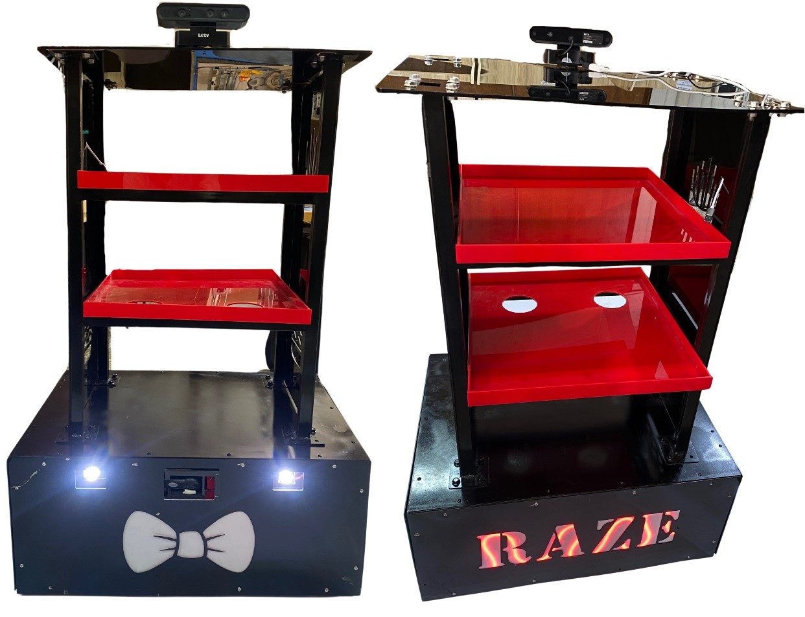
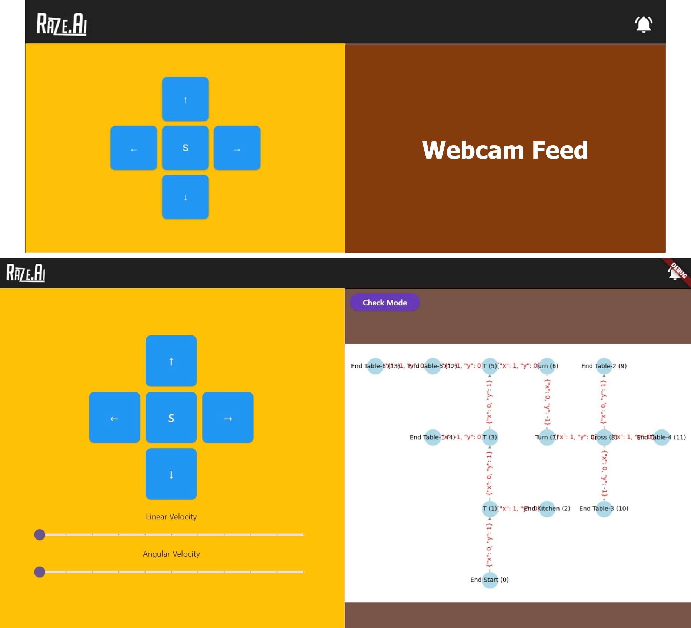
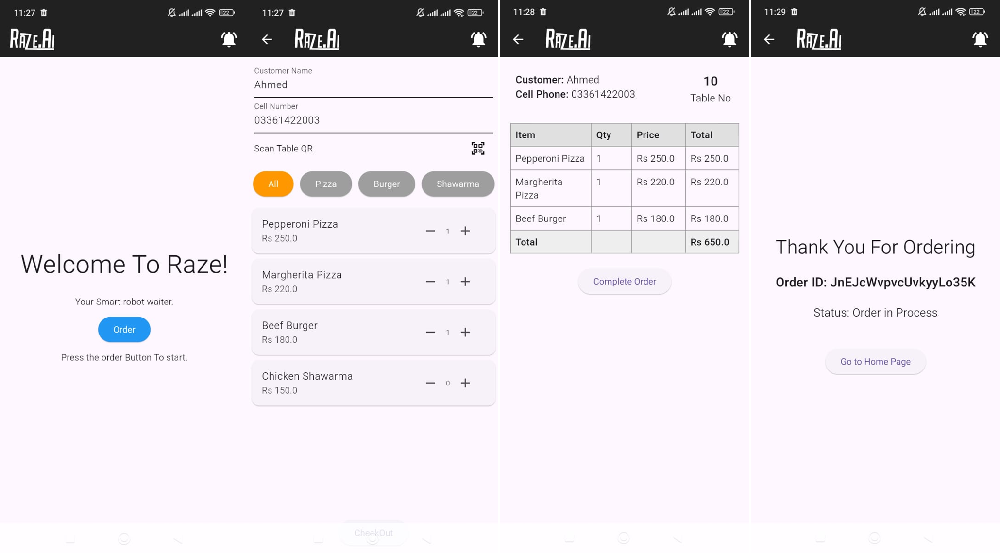
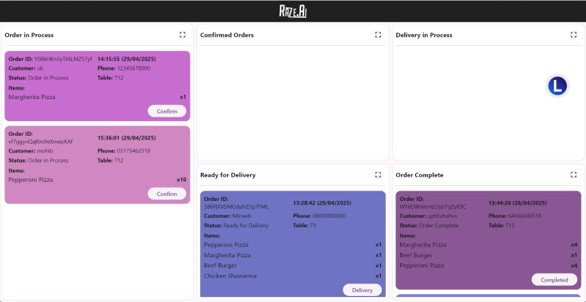
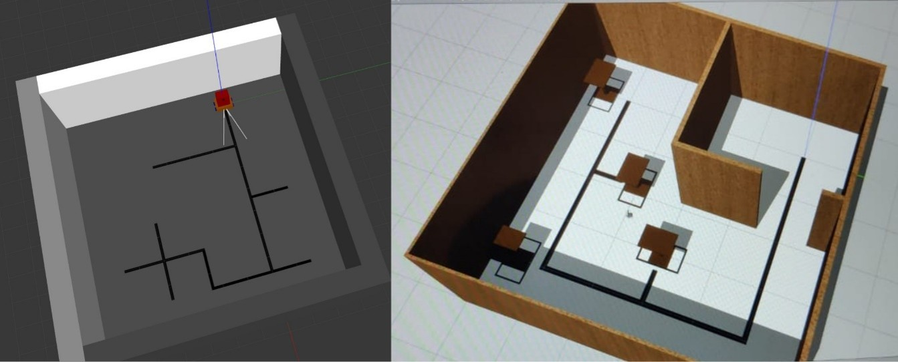
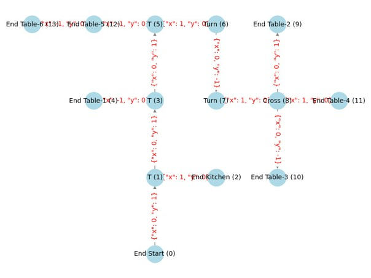
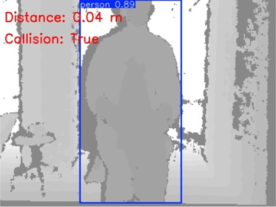

<div align="center">

# Mobile Robot for Smart Restaurants

**Muneeb Ahmad, Muhammad Zakriya, Ahmed Saeed, Mohib Ahmed**
Department of Mechatronics Engineering, College of Electrical and Mechanical Engineering
National University of Sciences and Technology (NUST), Rawalpindi, Pakistan, 2025

*Sponsoring DS: Dr. Uzair Khaleeq Uz Zaman, Dr. Anas Bin Aqeel, A/P Kanwal Naveed*


</div>

> **Notice.** This repository is shared privately for admission review only. Copying, redistribution, or reuse without written permission from the authors is not permitted. See [Copyright](#copyright).

<p align="center">
  
  <br>
  <em>The fully assembled robot.</em>
</p>

---

## Abstract

This thesis presents the design and development of an autonomous mobile robot tailored for indoor food delivery in restaurant environments. Aimed at enhancing service efficiency and reducing human dependency, the robot is capable of autonomously navigating restaurant layouts and delivering food from the kitchen to customer tables. The system leverages vision-based navigation, real-time image processing, and a camera-driven junction detection model to follow designated floor paths. Its mechanical structure supports a 20 kg payload and includes detachable trays for efficient loading and unloading. Control is achieved through an ESP32-based embedded system, integrating motors, sensors, and cameras for coordinated operation. The software stack is built using ROS2 and includes modules for line following, path planning, and basic obstacle detection. Results from both simulation and real-world testing confirm the robot’s effectiveness in mimicking waiter functions in structured settings. The project demonstrates a viable, low-cost approach to automating restaurant service and lays the groundwork for future enhancements such as SLAM-based free navigation and dynamic path re-planning.

<p align="center">
  
  <br>
  <em>Technical Team Maintaince App.</em>
</p>

<p align="center">
  
  <br>
  <em>Customer ordering App.</em>
</p>

<p align="center">
  
  <br>
  <em>Order Management App.</em>
</p>
---

## Table of Contents

1. [Technologies Used](#technologies-used)
2. [Navigation](#navigation)
3. [Collision Avoidance](#collision-avoidance)
4. [Results](#results)
5. [Limitations](#limitations)
6. [Future Work](#future-work)
7. [Repository Structure](#repository-structure)
8. [Getting Started](#getting-started)
9. [Copyright](#copyright)

---

## Technologies Used

1. ROS2: Robot Operating System 2 (ROS2) is an open-source framework of libraries and tools for building robot applications. It provides a modular publishing/subscribe architecture for inter-node communication, drivers for hardware, and integration with simulation tools like Gazebo. ROS2 was chosen for its support of distributed computing and real-time control in robotics.
2. Gazebo: Gazebo is a free, open-source 3D robotics simulation environment maintained by Open Robotics. It offers high-fidelity physics, sensor simulation, and a virtual world in which the robot URDF can be deployed. Using Gazebo allowed testing the robot’s behavior (locomotion, sensing) in a realistic virtual restaurant setting before real-world trials.
3. Flutter: Flutter is Google’s open-source UI toolkit for building natively compiled applications for mobile, web, and desktop from a single codebase. It was used to develop mobile applications in this project, enabling a smooth cross-platform user interface for both customers and operators.
4. Firebase: Firebase is a set of backend cloud services and real-time databases provided by Google for application development. In this project, Firebase was utilized to store order data, synchronize information between the robot and user devices, and manage user accounts. Its real-time data synchronization ensures that orders and robot status updates propagate instantly to all relevant devices.
5. OpenCV: OpenCV (Open-Source Computer Vision Library) is a popular open-source library of computer vision algorithms mainly aimed at real-time image processing. OpenCV was employed in the robot’s vision nodes for tasks such as line detection, perspective transformations, and image filtering to enable robust line following.
6. YOLO: YOLO (You Only Look Once) refers to a family of real-time object detection models that identify and classify objects in a single pass through an image. A custom lightweight YOLO-based model (YOLOv11n-cls) was trained and used to classify junctions on the floor (e.g., left turn, right turn, T-junction), assisting the robot in path decision-making during navigation.

<p align="center">
  
  <br>
  <em>Restaurant environment and navigation simulation in ROS2 and Gazebo.</em>
</p>

---

## Navigation

The waiter robot’s navigation strategy is built around following a predefined line path on the floor, colored red for high visibility under varying lighting conditions, and making decisions at junctions to reach target destinations. A downward-facing camera mounted on the robot serves as the primary sensor for line following. The raw camera feed passes through an image processing pipeline implemented with OpenCV. First, a perspective transform is applied (if necessary) to obtain a bird’s-eye view of the floor directly beneath the robot, correcting for the camera’s angle and providing a consistent frame for analysis. Next, to maximize contrast and processing speed, the image is converted directly into a binary form (rather than relying on grayscale or full-color processing). In this binary representation, the red guide line is sharply distinguished from the floor background by thresholding the image, resulting in a high-contrast black-and-white image where the line stands out clearly. This binary image is then analyzed by a custom algorithm to determine the line’s position relative to the robot’s center: for example, the largest continuous blob (contour) in the lower portion of the frame is recognized as the line. The centroid of this contour provides the lateral offset of the line from the camera’s centerline, and the contour’s orientation (or a fitted line using cv2.fitLine) yields the heading angle of the line. These two metrics, lateral deviation and angular deviation, represent the navigation errors that need to be corrected by the control system.

Initially, when the robot approached a junction (where multiple line segments intersect or diverge), a YOLOv11n-cls deep learning model was used to classify the junction geometry based on the visible line pattern. This model was trained to identify categories such as “Left turn,” “Right turn,” “T-junction,” “Crossroad,” or “Straight” by analyzing the configuration of the red guide line in the image. Although this model performed well under controlled conditions, its accuracy could fluctuate due to factors such as lighting changes, floor texture variation, and reflections. These limitations led to occasional misclassifications, particularly in cluttered or dimly lit environments. As such, the design was later enhanced by transitioning from the YOLO-based model to a marker-based system using ArUco fiducials for more reliable and consistent junction detection.

In the current implementation, the system employs a robust marker-based junction identification mechanism using ArUco markers. Each junction along the path is marked with a unique and easily detectable ArUco fiducial marker. These markers provide both an ID and pose information (i.e., their orientation and position relative to the robot’s camera), allowing the robot not only to identify the junction but also to determine how it is oriented with respect to it. For example, a marker with ID 6 may represent a T-left junction when viewed from the front, but if the robot approaches it from a 90° rotated perspective, the pose data indicates this relative viewpoint, enabling the system to correctly interpret the intersection geometry from its current approach angle. This capability significantly improves robustness, as it eliminates ambiguity caused by environmental factors and provides a consistent frame of reference for navigation.

The result of this detection process, the identified marker ID and its pose, is published as a discrete junction identification output that other software nodes in the navigation pipeline use for decision-making. This approach has proven more reliable in real-world conditions compared to the earlier vision-based model. Junction detection is now immediate, unambiguous, and unaffected by visual noise, ensuring the robot can confidently execute the appropriate maneuver at each intersection.

High-level path planning logic uses the confirmed junction information to guide the robot to its intended destination (such as a specific table). The layout of the restaurant’s corridors and intersections is represented internally as a graph structure, where junctions (and endpoints like tables or the kitchen) serve as nodes and line segments between them are edges. During an initial mapping phase (which might involve a one-time manual input of the known floor plan or an autonomous exploration), this graph is constructed and stored.

Each junction’s ArUco marker provides a unique ID that corresponds to a node in the graph, and the type of junction (inferred from the pose and marker ID) defines its connections to neighboring nodes. Once the graph is available, standard graph search algorithms such as breadth-first search (BFS) or depth-first search (DFS) are used to plan routes. For example, if the robot needs to go from the kitchen node to Table 5’s node, the planner will compute the sequence of junction nodes to traverse (e.g., Kitchen → Junction 3 → Junction 7 → Table 5), and this sequence is then translated into turn-by-turn instructions: go straight from the kitchen to the first junction, then turn left, proceed to the next intersection and turn right, and so on until the robot reaches the target node.

At runtime, the robot’s navigation node keeps track of its current position in terms of the graph (using the distance traveled along the path and by recognizing each junction’s ArUco marker when one is encountered) and knows the next expected turn or movement according to the route plan. As the robot approaches each upcoming junction, the identification from the marker is verified against the planned route to ensure the correct turn is executed. For instance, if the plan requires turning left at the next T-junction, the robot will verify that it has arrived at the correct T-junction (by reading the corresponding ArUco marker ID and interpreting its pose) before initiating the left-turn maneuver.

Throughout this process, a motor control node (the closed-loop controller) continuously adjusts the wheel speeds to follow the line smoothly. The lateral and angular deviations calculated by the vision system are fed into a proportional-derivative (PD) controller. In practice, the robot’s control algorithm sets a base forward speed and then applies differential steering corrections: if the line veers to one side, the wheel on that side is slowed down while the opposite wheel is sped up, proportional to the magnitude of the detected error. A derivative term helps to counteract sudden changes by damping the steering response, preventing oscillation, and ensuring that the robot converges back to the center of the path if it drifts off-course.

Moreover, the robot’s linear speed is modulated based on the complexity of the upcoming path segment and the magnitude of the tracking error. The robot will automatically slow down when approaching a sharp turn or a complex junction, providing more time to accurately execute the maneuver, and will speed up on long straight segments once it is properly aligned with the guide line. The result is a smooth line-following behavior that can handle gentle curves and intersections without jerky movements or losing the path. By combining vision-based line tracking, marker-based junction recognition, and graph-based path planning, the robot effectively navigates the restaurant environment to deliver orders to specified locations.

<p align="center">
  
  <br>
  <em>Restaurant node edge Map.</em>
</p>

---

## Collision Avoidance

Ensuring reliable collision avoidance is crucial for safe operation in the dynamic environment of a restaurant. The robot employs an Astra Pro depth camera, mounted at the top of its frame, to continuously monitor the surroundings for obstacles. This depth camera feeds live 3D data to the onboard laptop, which runs the robot’s perception algorithms in a ROS 2 environment. An object detection model based on YOLO is used to analyze the camera’s video stream in real time. The YOLO-based detector identifies potential obstacles (such as people, furniture, or other objects) in the camera’s field of view and, by using the corresponding depth information, determines their distance from the robot. This sensor configuration and vision algorithm work in tandem to provide timely detection of any obstacle in the robot’s path.

The collision avoidance routine operates as follows:

1. Continuous Perception: The top-mounted Astra Pro depth camera continuously scans the robot’s forward path and publishes synchronized color and depth images to a ROS 2 topic. A dedicated YOLO-based object detection node subscribes to this feed and processes each frame to recognize obstacles in real time. By leveraging the depth data, the system can judge how close a detected object is to the robot.
2. Obstacle Detection and Halt: If the object detection module identifies an obstacle directly ahead within a predefined safety distance threshold, the robot’s control system triggers an immediate stop. This is accomplished by the ROS 2 navigation stack sending a zero-velocity command (geometry_msgs/Twist with linear velocities set to zero) to the motor controller. The low-level motor control is handled by an ESP32 microcontroller running micro-ROS, which subscribes to the velocity command topic. Instead of directly driving the motors at a fixed output, it uses feedback from wheel encoders to adjust PWM signals so that the actual wheel speeds match the commanded speeds. This closed-loop control ensures that if the robot is told to stop (velocity command zero), the motors are actively braked to zero motion and hold there, even on slopes or if carrying a load. Similarly, if an obstacle is detected and the main ROS node commands a stop, the microcontroller will ramp down the motor speeds smoothly to avoid abrupt jerks. The micro-ROS framework enables this microcontroller to act as a ROS2 node, meaning it can publish sensor readings (like wheel encoder ticks or IMU data) and subscribe to movement commands seamlessly. The motor driver node on the ESP32 implements a simple proportional controller for speed: it increases or decreases the motor PWM until the measured encoder rate matches the desired speed, and maintains it. This not only provides precision in navigation but also contributes to safety: if the robot were to, for example, hit a small bump or encounter resistance, the controller would adjust power to maintain control, rather than the robot lurching unexpectedly.
3. Wait Period: After halting, the robot remains stationary for a brief waiting period (on the order of a few seconds). This pause is intended to give the obstacle a chance to move out of the way on its own. For instance, if a person is walking in front of the robot or momentarily blocking its route, they may naturally clear the path within a couple of seconds. The robot’s software simply maintains the stopped state during this interval, continuously monitoring the camera feed to check if the obstacle is gone.
4. Audible Warning: If the obstacle persists in the path after the short wait, the robot then issues an audible warning to prompt clearance. The onboard laptop’s speakers play a pre-recorded message or sound (for example, a polite spoken request such as “Excuse me, please clear the way”) to alert nearby people of the robot’s presence. This audio alert is intended to draw human attention and politely request assistance in removing or bypassing the obstacle. The system uses ROS 2 audio output capabilities to automate this warning step as part of the collision avoidance behavior.

<p align="center">
  
  <br>
  <em>Depth camera detecting a person and measuring distance.</em>
</p>

---

## Results

The project was overall a success, the four deliverables for the project were achieved and the team succeeded in fabricating a functioning, low cost, autonomous waiter robot. The total cost of the project was around 160,000 PKR, an amount which can be reduced by around 25% simply by producing the robot in greater numbers. A more quantitative analysis of the robot’s success rate is given in the table below, which shows that the robot successfully delivered the payload 93.33% of the time, recording 1 drink spilled over 30 runs and 1 navigation failure.

**Results of Testing in Final Configuration**

| | No. of Tests in Final Configuration | Successful Runs (Navigated & Delivered) | Partial Failures: Navigated but did not deliver | Partial Failures: Delivered but did not navigate | Failed Runs |
|---|---|---|---|---|---|
| With Only Food | 10 | 9 | 0 | 1 | 0 |
| With Only Drinks | 10 | 9 | 1 | 0 | 0 |
| With Food & Drinks | 10 | 10 | 0 | 0 | 0 |
| **Total** | **30** | **28 (93.33%)** | **1** | **1** | **0** |

---

## Limitations

- Structured Environment Dependency: The robot was designed to operate using predefined line paths laid on the floor, limiting its applicability to only those environments where physical path markers can be deployed. As a result, the robot is currently unsuitable for dynamic or unstructured restaurant layouts.
- Simplified Navigation Approach: Full autonomous navigation through SLAM or advanced path planning was intentionally excluded due to time and complexity constraints. This simplified the software pipeline but restricted the robot’s ability to adapt to real-time environmental changes or customer-driven route flexibility.
- Lack of Dynamic Path Re-planning: The robot currently uses a static, line-based path-following approach with no capability to reroute around obstacles. If a path is blocked, the robot stops and waits rather than navigating around it.
- Limited Interaction Design: The project prioritized core service delivery functionality and basic UI for order placement. Advanced features such as voice recognition, gesture-based controls, or complex human-robot interaction modalities were excluded to keep the system scope focused and manageable.

---

## Future Work

1. Transition to Full Autonomy via SLAM
2. Real-Time Path Re-Planning and Dynamic Obstacle Avoidance
3. Commercialization
4. Fleet Management and Multi-Robot Coordination
5. Design Optimizations
6. Enhanced Human-Robot Interaction

---

## Repository Structure

```
.
├── README.md
├── LICENSE
├── src/
│   ├── camera_line_follow/    # line following and junction classification
│   ├── depth_core/            # depth camera collision avoidance
│   ├── master_controller/     # navigation, graph, path planning, motor control
│   └── robot_interfaces/      # custom ROS2 messages
├── esp32_code/                # ESP32 firmware
├── model_train/               # junction classifier training
└── assets/                    # images used in this README
```

---

## Getting Started

**Requirements:** Ubuntu 22.04, ROS2 Humble, Gazebo, OpenCV, Flutter SDK.

```bash
git clone https://github.com/muneebahmed26301/Mobile-Robot-for-Smart-Restaurants_1.git
cd Mobile-Robot-for-Smart-Restaurants_1
colcon build
source install/setup.bash
```

Firebase credentials, API keys, and trained model weights are not included in this release. Place your own Firebase service account key in `src/master_controller/creds/`.

---

## Copyright

Copyright (c) 2025 Ahmed Saeed, Mohib Ahmed, Muneeb Ahmad, Muhammad Zakriya. All rights reserved.

This repository is shared solely for admission review. No license is granted to copy, modify, distribute, or use this code for any other purpose without written permission from the authors.

**Contact:** `[muneeb.nust.mts.2021@gmail.com]`
